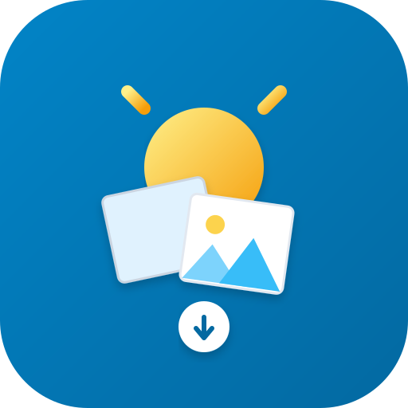

<p align="center">
  
</p>

# MyBrightDay Backup

A tool to automatically backup photos from the Bright Horizons MyBrightDay application, with optional upload to Google Photos.

## Getting Started

### Automated Daily Backup (GitHub Actions) — Recommended

This repository includes a GitHub Actions workflow to automatically download your photos every day and back them up directly to Google Photos, requiring no local server or download. This is the easiest way to get started.

To set this up for your own account:
1.  **Fork this repository**: Click the "Fork" button at the top right of this page to create your own copy.
2.  **Add one secret**: Go to your fork's **Settings** > **Secrets and variables** > **Actions** and add a repository secret named `MBD_STATE_KEY` containing the output of `openssl rand -hex 32`. It encrypts your logins between runs. Paste it exactly as generated; it must be random, not a passphrase you made up, because the encrypted logins live in the repository's Actions cache, which anyone able to run a pull-request workflow in your fork can read.
3.  **Enable the Workflows**: Go to the **Actions** tab in your fork and enable both the "Daily Backup" and "Keep Alive" workflows. Keep Alive runs weekly and exists only to stop GitHub auto-disabling the Daily Backup after 60 days of repository inactivity.
4.  **Log in (two runs)**: Open "Daily Backup", click **Run workflow**, and run it with the boxes empty. It stops with a message in the job summary containing two links: one to log in to MyBrightDay, one to sign in to Google. Open each, sign in, and you will land on a page that says "This site can't be reached" — that is expected. Copy the whole address from the address bar each time, then run the workflow again with the two addresses pasted into the **mybrightday_callback_url** and **google_callback_url** boxes. That run saves both logins and does your first backup. The links are valid for ten minutes.

That's it. Your logins are kept encrypted in the repository's Actions cache. The MyBrightDay login lasts about a year; the workflow warns in its summary for thirty days before it expires, and when it does, the next run shows the same login message and you repeat step 4 for MyBrightDay only.

### Running Manually

Download the latest binary for your operating system from the [Releases](https://github.com/dipeshc/mybrightday-backup/releases) page.

1.  **Download Photos**:
    Download photos for a specific date or range. The first run opens your browser to log in to MyBrightDay and saves the login under `./config/`; later runs use it without asking.
    ```bash
    ./mbdb --date=2026-06-15
    ```

    You can also specify date ranges or relative offsets:
    ```bash
    ./mbdb --date -7:0                   # Last 7 days
    ./mbdb --date 2024-01-01:2024-01-31  # Entire month
    ./mbdb                               # Defaults to today
    ```

1.  **Upload to Google Photos** (Optional):
    Enable the Google Photos destination. The first run with it enabled opens your browser to sign in to Google and saves that login too.
    ```bash
    ./mbdb --googlephotos.enabled
    ```

    Running somewhere without a browser, such as a server? The run prints the login links instead and stops. Open them on any device, then run again passing the address you land on for each with `--callback-url`.

## Configuration Overview

Configuration can be set via CLI flags, environment variables, or a `config.yaml` file. The application follows a strict resolution hierarchy: **CLI Flags → Env Vars → Secret Files → Config File → Defaults**.

Commonly used options:
- `--date`: Date or range (e.g., `YYYY-MM-DD`, `-1`, `-7:0`).
- `--local.directory`: Where to save photos locally (default: `./photos`).
- `--googlephotos.enabled`: Enable uploading to Google Photos.
- `--dryrun`: Preview actions without downloading or uploading.

For a full list of options and details on the configuration system, see the [Configuration Reference](docs/configuration.md).

## Troubleshooting & Known Issues

* **Google Photos Unverified App Warning**: By default, the application uses an embedded Google Cloud project for OAuth. Because this project is not officially verified by Google, you will see a warning screen saying "Google hasn't verified this app" when signing in to Google. You can safely click "Advanced" and "Go to MyBrightDay Backup (unsafe)" to proceed. Alternatively, you can configure your own Custom Google Cloud Project (see the [Google Photos Guide](docs/google-photos.md)).
* **"MyBrightDay rejected the stored session"**: The login expired (about a year after logging in) or was revoked, for example by logging out of the MyBrightDay website. The tool clears it. Locally, the next run opens the browser to log in again; on GitHub Actions, the same run writes the login message to its job summary.
* **"Google rejected the stored Google Photos login"**: Google revoked or expired the token (for example after you removed the app's access in your Google Account). The tool clears it and asks you to sign in to Google again, the same way as for MyBrightDay. If the message names the environment variable, flag, or config file instead, the dead token is coming from there rather than from a login this tool made; on GitHub Actions a login made through the workflow takes over automatically, so just repeat the two-run login, and otherwise remove or replace that value.
* **"The login link has expired"**: Login links last ten minutes. Run again without the callback address to get a fresh one.
* **"MyBrightDay login needs port 4200"**: Bright Horizons only allows the login to return to `localhost:4200`, so the port cannot be changed. Free the port, or follow the on-screen instructions to finish the login by pasting the address you land on.
* **Login message after a quiet week**: GitHub removes cache entries that have not been used for seven days. If the workflow does not run for a week (disabled, or paused), the stored logins are gone and the next run shows the login message; repeat the two-run login.
* **One login per machine**: Each machine or workflow should make its own login. The GitHub workflow and a laptop can both be logged in at once.
* **Why a password login no longer works**: Bright Horizons' login provider shows a CAPTCHA to anything that is not a real browser, which is why the tool logs in through your browser once and keeps the resulting session instead of your password.

## Documentation

For more detailed information, please refer to the following guides:

*   [**Configuration Reference**](docs/configuration.md): Full list of all flags, environment variables, and YAML keys.
*   [**Google Photos Integration**](docs/google-photos.md): Detailed setup guide and explanation of the deduplication strategy.
*   [**Backup Workflow**](docs/backup-workflow.md): A step-by-step look at how the application fetches and processes data.
*   [**Metadata & Image Processing**](docs/metadata-and-processing.md): Information on how EXIF data (GPS and timestamps) is generated and injected.
*   [**Architecture & Repo Structure**](docs/architecture.md): Codebase layout, storage module pattern, and the config system.
*   [**Development Guide**](docs/development.md): Instructions for building the project and contributing code.
